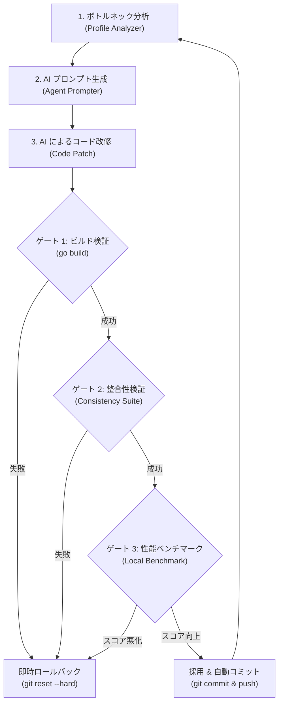

# ISUCON2026 自律稼働ハーネス (Autonomous Optimization Harness)

AWS 実機環境がない状態、およびモデル消費トークンを抑えながら、AI エージェントが自律的に Go コードの改善・検証・採否判定（コミット / ロールバック）を安全に実行するためのテスト＆ゲート基盤です。

---

## 1. 全体アーキテクチャ



---

## 2. ゲートの詳細

| ゲート | 検査内容 | 目的 |
|---|---|---|
| **Gate 1: ビルド検証** | `go build` | コンパイルエラー、型不一致、未定義参照を弾く |
| **Gate 2: 整合性検証** | `consistency_checker.py` | 署名検証の失敗条件、HTTPステータス、レスポンス形式が破壊されていないか検証 |
| **Gate 3: 性能ベンチマーク** | `bench_runner.py` | RPS、レイテンシ（P50/P90/P99）を並行負荷で測定し、総合スコアを算出 |

---

## 3. ファイル構成

* `harness/autonomous_engine.py`: 統括コントローラー（ビルド、整合性、ベンチマーク、Git ロールバック/コミットの一元管理）
* `harness/bench_runner.py`: Python 標準ライブラリのみで動く高精度並行 HTTP ベンチマーカー
* `harness/consistency_checker.py`: API コントラクト（仕様）破壊を防止するテストスイート
* `harness/profile_analyzer.py`: CPU 消費上位関数を抽出して Markdown 指示を生成するモジュール
* `harness/agent_prompter.py`: AI エージェント（Antigravity / Claude Code）向けの指示書を動的生成

---

## 4. 実行方法

### 1回の評価サイクルを手動で実行する場合
```bash
python harness/autonomous_engine.py "image signature precomputation" 625000
```

### AI プロンプトの生成
```bash
python harness/agent_prompter.py image_signature.go SignImageURL
```
